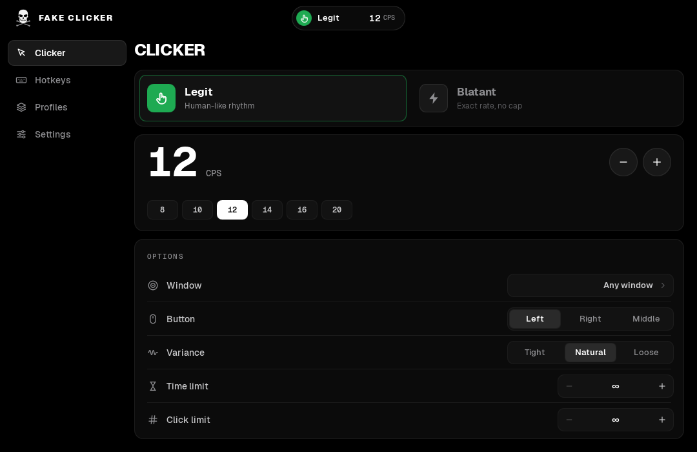

# Fake Clicker 0.8.0



Native C++20 / Qt Quick 6.8.3 auto clicker for Windows 10/11 x64. One dark monochrome interface,
an animated skull mark, a Dynamic Island, two click engines and an uncapped custom rate.
English by default, Russian included. Design notes: **DESIGN.md**; sources: **REFERENCES.md**.

## Click modes
| Mode | What it does |
|---|---|
| **Legit** (green) | Human emulation. Each gap gets log-normal jitter around the target rate, a slow tempo drift, rare hesitations and quick doubles, a short warm-up, and a finger-like press duration that shrinks as the rate rises. A mean correction keeps the long-run average within ~2% of the target. *Variance*: Tight / Natural / Loose. |
| **Blatant** (red) | Direct clicking, no emulation. Exact fixed grid with no drift. When the rate outruns the Windows timer, due clicks are sent together in one `SendInput` batch (up to 128 pairs per wake), so very high rates are reachable. Optional hold in ms (0 = press and release together). |

**Custom CPS.** Type any positive value (decimals allowed) into the large number or use − / + and
the presets. There is no upper limit in the UI; the only technical bound is one click per
nanosecond. What a target app actually receives depends on Windows and that app. Legit is
timer-paced and practically tops out around ~1000 CPS; uncapped throughput is a Blatant feature.

## Interface
- **Launch:** the skull bites twice while the loading bar fills with real startup progress, then the
  interface fades in (about a second). Closing is a short fade.
- **Layout:** the standard Windows title bar (Settings → Window switches to the app's own, with its
  own window buttons); under it the skull, the wordmark and the island in the centre; a sidebar with
  Clicker, Hotkeys, Profiles and Settings; pages with uppercase titles and graphite panels. The
  Clicker page holds Mode, Rate and Options (window, button, variance or hold, limits); countdown,
  live rate, clicks and Start/Stop are on the island.
- **Colour:** black, graphite and white only. Green marks Legit, red marks Blatant, Stop and errors.
- **Motion:** short eased transitions (110–260 ms). No springs, bounces, glass or blur.
- **Sound:** short original cues for actions — a soft tick for buttons and navigation, a two-step
  click for switches, a step for −/+, countdown ticks, a rising Start, a falling Stop, a chime when
  a time or click limit ends the run, confirm/remove/error for saves, deletes and failures, and the
  clack of the skull's teeth on each launch bite. Settings → Sound turns them off or sets the
  volume (10–100 %). Windows plays them through XAudio2; nothing is played per click.

**Dynamic Island.** Compact views show mode and target CPS, a countdown ring, a live waveform with
measured CPS, notices, errors and a run summary. **Hover expands it** into a control panel:
Legit/Blatant switch, a large CPS readout with −/+, live clicks and time, and a Start/Cancel/Stop
button. Every real change is announced as *what changed* + *new value* with its own icon — for
example `Island over other windows  [OFF]`, `Start  [F7]`, `Click limit  5,000`, `Mode  Blatant`.
While you click in another app, the island moves to a passive, input-transparent overlay at the top
of the screen (or of the chosen window); Settings can turn that off.

**Target window.** The button above Start opens a window picker with live thumbnails. With a window
chosen, Start brings it to the front, clicks only while it stays in front, and the overlay island
sits at the top of that window. "Any window" clicks whatever is in front when the countdown ends.

## Hotkeys and profiles
Raw Input physical-key bindings: 1–3 keys per shortcut, up to 8 alternatives each for start and
stop, side-specific Ctrl/Alt/Shift, AltGr and PrintScreen. Defaults are F6 to start and F8 to stop.
**Reset** next to the countdown restores the default 3 s. Profiles are JSON (`"format":
"fake-clicker"`, version 4); profiles from Light clicker and earlier versions still import. Settings
and profiles live in one folder, `%APPDATA%\FakeClicker` (`FakeClicker.ini` and `configs\`). On the first
start the app copies them from the old ObsidianClick location (registry and `%LOCALAPPDATA%\ObsidianClick`)
and leaves the old copy untouched.

## Safety behaviour
Clicking runs only while the window that was in front at the end of the countdown keeps focus and
the cursor is safely over it. Briefly leaving the target or crossing a foreign window pauses
injection; it resumes on re-entry while the target keeps focus. The passive island does not count
as a foreign window. A press is always followed by its release. Closing the app stops input before
the closing fade. The EXE is unsigned; do not disable Windows protection to run it.

## Build
Requires CMake ≥ 3.24, C++20 and Qt 6.8.3 (Quick, QuickControls2, Concurrent, Svg).
```sh
# Native (Linux/Windows) build and tests
cmake -S . -B build -DCMAKE_PREFIX_PATH=/path/to/Qt/6.8.3/gcc_64 -DCMAKE_BUILD_TYPE=Release
cmake --build build --parallel
QT_QPA_PLATFORM=offscreen ctest --test-dir build --output-on-failure
# Windows EXE from Linux (MinGW-w64 13 posix + Qt 6.8.3 mingw_64 kit)
QT_HOST_PATH=/opt/Qt/6.8.3/gcc_64 QT_WIN_PATH=/opt/Qt/6.8.3/mingw_64 scripts/build-cross.sh
# Packages into an empty folder: DLLs from a static import audit, qml/plugins, docs, examples,
# licences, build-info.json and SHA256SUMS.txt
python3 scripts/package-windows.py --qt "$QT_WIN_PATH" --exe build-cross/bin/FakeClicker.exe \
  --receiver build-cross/FakeClickerReceiver.exe --runtime <dir with MinGW runtime DLLs> --output dist/FakeClicker
# Screenshot tour (needs X11/Xvfb and OpenGL): writes PNGs for every screen and state
xvfb-run -a build/bin/FakeClicker --capture shots
# Slow-motion launch frames (the skull's bite)
FAKECLICKER_MOTION_SCALE=6 xvfb-run -a build/bin/FakeClicker --capture shots-launch
# App icon from the skull SVGs (needs rsvg-convert and ImageMagick)
scripts/render-icon.sh
# Interface sounds into assets/sounds (plain Python, no dependencies)
python3 scripts/render-sounds.py
```
`FakeClickerReceiver.exe` is a test window that counts the clicks it receives, so you can check the
real delivered rate on Windows.

## Limitations
Built and packaged by cross-compiling on Linux. The Windows executable was not run on Windows (see
QA.md); physical Windows input (SendInput delivery, Raw Input on real keyboards, DPI, the Windows 11
frame colour) needs testing on real Windows. Fn and OS-intercepted keys are not guaranteed; Win and
F12 cannot be bound. Raw Input does not reserve hotkeys exclusively.
